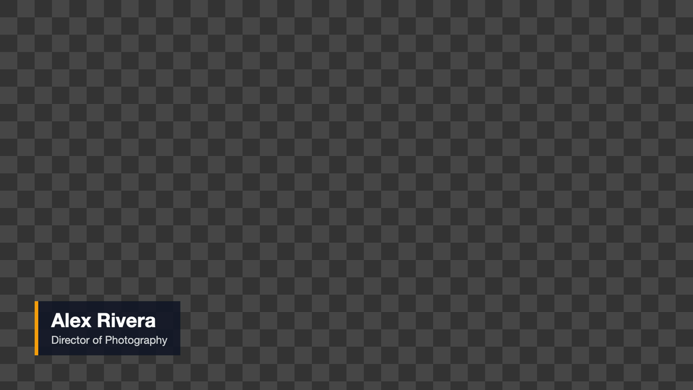
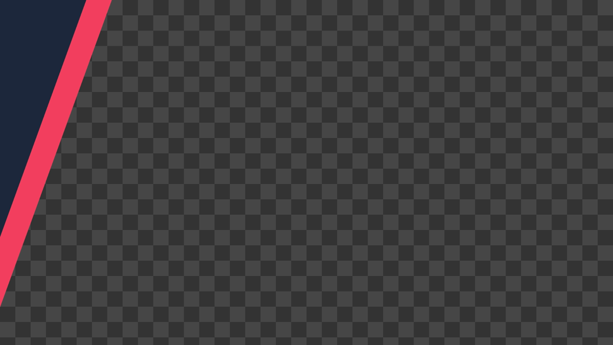
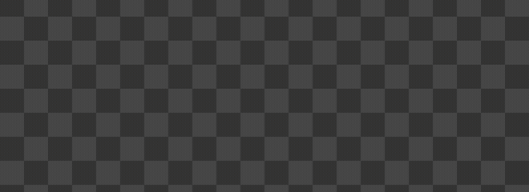

# Pulp

[](https://github.com/plutado/pulp/actions/workflows/ci.yml)
[](LICENSE)
[](https://www.electronjs.org/)
[](https://www.typescriptlang.org/)

Pulp is a desktop app for video editors who use motion-graphics templates: lower thirds, titles, transitions and overlays. You browse a library of templates, preview them, change their text, colors and fonts, and render them to files your editing software can use, including formats that keep the alpha channel so the graphic sits on top of your footage.

Templates use an open, documented format: a folder with a `template.json` manifest and an HTML/Canvas animation. Anyone can write one with a text editor, and there is no lock-in to a store or a subscription. Pulp also indexes your own media folders so templates and footage can be searched together.

"Pulp" is a working name and may change.

**Status: early development.** The renderer, the template format, search, categorization, template packs, drag-out to editing apps, the window shell, the card grid, the player, collections, vertical and square formats, image slots, layers and moving layers on the stage are in place. Assets on the stage is done: asset libraries of your own with transparency detected, video layers, and dropping a picture or a clip onto the preview to make it a layer. Layers can now be moved, resized and turned on the stage, and a graphic's length can be set while editing: backgrounds repeat, transitions play faster or slower, and a template with an entrance and an exit stretches only its hold. A session can now be saved as a `.pulp` project, with unsaved changes guarded, autosave recovery and media that moved relinked, and Pulp has its own application menu on every platform. The player's controls sit in a transport row across the bottom of the window, so the stage is only the picture and the scrub bar has the window's width; the inspector opens from that row as a drawer over the results, and with the right column gone the stage and the results span the window's full width. Nothing empty takes room from the stage: an empty collection tray is not in the window at all, empty results fold to their heading, and the status items sit at the end of the transport row. The stage can pop out into a window of its own on any display, with everything on it still working, or fill a chosen monitor from View → Stage on Display, and comes back by the same button. Social-ready export is done: platform presets that set the aspect, size, frame rate and encoder together, length and file-size warnings before and after a render, a cover image, and the hand-off — the share sheet on macOS, or the platform's upload page opened with the file shown beside it. Footage is worked on as well as graphics: a shot can be tracked and a layer pinned to what it follows, reframed for a tall frame by following its subject, steadied, and converted from a phone's HDR; music dips under a voice by itself; and the timeline draws each shot's frames along it like a film strip. Text in Arabic, Hebrew and the Indic scripts is shaped properly and the window mirrors for a right-to-left language. 1.0 hardening and installers are still to come. Expect breaking changes to the format and the app until 1.0. See [ROADMAP.md](ROADMAP.md).

![Pulp's window: on the left the library panel, with the search field, its filter chips and an "in: Lower thirds" scope chip above the browse tree of categories and their counts; in the center the stage showing the Lower Third Bar template — a name and title on a dark panel with an amber accent — over a transparency checkerboard, with a row of template cards and their badges below it; the inspector's Parameters tab risen as a drawer over those cards; and across the bottom the transport row with the scrub bar, the timeline lanes named at their left, the playback controls and the Parameters, Output and Info buttons](docs/images/app-window.png)

*The library panel on the left holds Search — the field, the scope chip for the category being browsed, the filter chips and the For…, Look and Mood selects — over Browse, the tree of what things are, each node with its count. The center is the stage, all picture, with the results under it as cards with badges. The inspector is a drawer that rises from the transport row over the results, here on Parameters. The transport row spans the window: the scrub bar with the timeline lanes under it, each named at its left (here Layers, since this project has no shots), the playback controls, and the Parameters, Output and Info buttons with the status items at their end. The collection tray is in the window only while it holds something, so it is not here. Panes resize and collapse, and the layout is remembered; this picture is taken with the split dragged to show the stage and the cards at once. Everything shown is from the bundled sample templates, with `npm run images`.*

[docs/user-guide.md](docs/user-guide.md) walks through the regions, the keys and the search syntax; the window opens the same page from **Help → User Guide**.

### Sample output

Frames rendered by Pulp's own command line (a still with alpha) and composited over a checkerboard so the transparent areas are visible. Every picture on this page — these three, the animation below and the window above — is made by `npm run images` ([scripts/make-images.mjs](scripts/make-images.mjs)), so they can be made again whenever the app moves on.

| Lower Third Bar | Diagonal Wipe | Title Card |
|---|---|---|
|  |  |  |
| Transparent except for the name strap | Transparent outside the bands | Opaque by design (solid background) |

The lower third animating in, holding and animating out (a 15 fps GIF of the 30 fps render):



## Who it is for

- Solo editors and YouTubers who need clean, consistent graphics without opening a motion-design app for every name strap.
- Small studios that want a shared, versionable library of house-style templates.
- Anyone who writes HTML/Canvas and wants to make templates for editors.

## What works today

- Library scan of the bundled samples and any folders you add: templates are validated; media files (video, image, audio) are indexed with tags from folder names and metadata from ffprobe, with cached thumbnails and preview in the app (video, image and audio play in the stage).
- Search with free text plus filters: `tag:`, `type:` (video, image, audio, or a taxonomy type or group such as `type:whoosh`, `type:transitions`), `theme:`, `style:`, `mood:` (how a sound feels: upbeat, dramatic, calm…), `category:`, `pack:`, and from metadata `duration:>5`, `width:>=1920`, `height:`, `fps:`, `res:1080p` (also `4k`, `hd`), `codec:prores`, `alpha:yes`, `orientation:portrait`, `favorite:yes`, `recent:10`. Scope the search to Favorites, Recently used or one folder from the browse panel; narrow with filter chips (templates, video, images, audio, vertical, alpha, favorites); sort by relevance, name, recently used or duration. The last eight searches are remembered. Your tags and favorites are kept in the library database and survive folders going offline.
- Live preview, with a transport row across the bottom of the window: play, scrub, frame step and a loop toggle (templates open on their mid-progress frame, so transitions don't show a blank first frame), Set in / Set out marks that are the render's trim, timecode, volume and mute, and under the scrub bar a bar per layer; on the stage itself a background of your choosing behind transparency (checkerboard, black, white or any color) and a title-safe and action-safe overlay; hover a card to scrub through eight frames of it without opening it. Audio files show a waveform in the stage and in every list row, and audition mode walks a folder of sounds with the arrow keys, playing each as it comes up. A parameter form generated from the manifest: color pickers with alpha and recent colors, sliders, character counters, per-template undo/redo, saved parameter presets, and batch rendering from CSV.
- Rendering through ffmpeg to ProRes 4444 (alpha), ProRes 422 HQ, DNxHR HQ and HQX for Avid and the editors that prefer it, PNG sequence (alpha), a single still image (PNG with alpha), QuickTime Animation (alpha), WebM VP9 (alpha), H.264 MP4 and, on macOS, HEVC with alpha — with frame-rate override, background flattening and in/out trim. For a page or a chat with no editing app, **GIF** with a palette made for the clip, **animated WebP** and **APNG**, the last two keeping alpha, all three looping forever and with a frame rate and width of their own. Alpha import verified in Premiere Pro and DaVinci Resolve on macOS ([docs/nle-verification.md](docs/nle-verification.md)).
- Drag a finished render from the queue into your editor's bin or timeline, or "Prepare for drag" to render into a managed cache first; verified in Premiere Pro and Resolve on macOS.
- A Pulp panel inside the editing apps: a panel for Premiere Pro (CEP) and for DaVinci Resolve Studio (Workflow Integration) lists the running Pulp's library and collection, searches them with Pulp's own query syntax, and **drops into the edit** — every row imports into the bin, goes onto the timeline (at the playhead in Premiere; appended, or dropped there by a native drag, in Resolve), each rendered on request with the item's own output settings and ProRes 4444 where none are saved, so the graphic keeps its alpha, through the same cache as Prepare for drag so a second drop is instant. **Open** on a row shows the item in Pulp to change it — or opens the collection card for editing — and Pulp's render queue is in the panel as it runs, with a cancel, a finished render dropping like any row. The connection never leaves the machine — 127.0.0.1 only, off by default (Settings → Serve the editor panel), every request carrying a token from a file beside your settings that only you can read ([docs/editor-panels.md](docs/editor-panels.md), decision record 0025). `npm run panels:package` makes one installable archive per host, and the panel's own code is tested against a stand-in host without either app installed.
- Template packs: import a `.zip` or folder with a license-and-collision preview, export the listed templates as a pack.
- Still backgrounds: 34 bundled CC0 templates that hold still — mesh, conic, aurora and dusk gradients, diagonal bands and sunburst rays; paper, linen, concrete, slate, brushed metal, carbon fiber, marble, terrazzo and kraft textures; isometric cubes, hexagon tiles, argyle, chevrons, pegboard, halftone, blueprint and contour patterns; bokeh, a studio sweep, a watercolour wash, confetti and a velvet spotlight — each with its colors, angle, pattern scale and grain as parameters, at every aspect. Made as templates rather than pictures, so one recolours to a palette and fits a tall frame as readily as a wide one.
- Objects on transparency: 33 bundled CC0 vector props — sports, celebration, holiday, business, science, media, nature, travel, home and community — each with its colors as parameters and a light entrance, sharp at any size, and placeable on the stage as a layer.
- Effects on transparency: 33 bundled CC0 effects — fire, smoke, sparks, explosions, energy, light, weather, liquids, confetti and brush strokes — each with a color, speed, density and size, looping seamlessly or playing once, and each one placeable on the stage as a layer over a title, a clip or a still.
- Platform presets for social-ready export: choose **TikTok**, **Instagram Reels**, **Instagram feed**, **YouTube Shorts**, **YouTube**, **X**, **LinkedIn** or **Facebook feed** at the top of the Output tab and the aspect, resolution, frame rate and encoder are set together, with what the platform takes said underneath and the date those limits were read, because this is data that ages. The same presets sit under Get going on the start screen, so a new project can start for a platform and every item then opens set up for it. Before a render, the length the trim leaves and the file size the bitrate target implies are checked against the platform's limits; after it, the file itself is, and what is past a limit is a warning on the Output tab and on the finished job — never a refusal, since a limit may have moved and you may know something the list does not. Once the render is done its card hands it over: **Share…** opens the system share sheet (macOS), and **Open upload page** opens the platform's own upload page in the browser with the file shown in the file manager, ready to drop. `--platform tiktok` on the command line. No accounts and no posting through anyone's API: Pulp makes the file the right shape and size and hands it over (ADR 0020).
- A cover image beside a render: tick it in the Output tab, pick the frame on the scrub bar — the playhead's to begin with, editable after, marked on the bar where it will be taken — and Pulp writes `<name>-cover.png` beside the video at the same size, for the thumbnail a platform asks for separately. It can be any frame of the graphic, not only one inside the trim, and it keeps alpha where the render has alpha or is flattened over the same background where it has none. `--cover-at 2.0s` on the command line.
- Sound in a project: **Add layer → Audio** puts music or a voice-over under the whole piece — or drop a sound from the results straight onto the stage — with an in and an out point in seconds, a start delay, loop or play once, a volume, a mute and a fade in and out. Every layer's sound plays together in the preview, held to the transport and under its volume and mute, and the render carries the same mix: AAC in MP4, PCM in the QuickTime presets, and a WAV beside an image sequence or any output with no room for an audio track. Every layer with sound shows its **waveform on its bar** under the scrub bar, resampled to the project's time — through the in point, the loop, a clip's speed, the delay and the fades — so a cut lines up with a beat or a word, and dragging the bar moves when the music is heard. A **loudness meter** in the transport row shows what the mix measures (EBU R128) against the chosen platform's target, and a render aimed at a platform preset is **leveled to that target** in two passes — measured, then one transparent gain — so what is uploaded is what is heard. A project with no sound renders no audio stream, shows no meter, and is leveled by nothing.
- Keyframes on layers: a layer's position, scale, rotation and opacity over time, each key eased its own way — linear, ease in, ease out, ease in and out, hold, or a cubic bezier of its own. Turn keyframing on for a layer and moving, scaling, turning or fading it writes a key at the playhead; a keyed layer moves by its keys instead of where it was placed, composed around the template's own motion — and its own entrance, exit and span — and the preview and the render agree to the frame. Every key is a mark on the layer's bar under the scrub bar: dragged in time, moved by the arrow keys, copied and pasted at the playhead from its right-click menu or Ctrl/Cmd+C and V, and deleted there or with Delete.
- Clip clean-up for compositing: **Key out a color** renders a green- or blue-screen clip to an alpha clip beside the original, picked straight off a frame with tolerance and spill, its sound kept; a **`.cube` LUT** grades a video layer, a clip or the whole render (`--lut` on the command line), shown in the preview where a layer carries it; **Split at its cuts** finds a long file's scenes and stream-copies them — no re-encode — into clips beside it; and the mix is leveled to the platform's loudness target with a meter in the transport row.
- Motion tracking: right-click something moving in a shot on the cut track — **Track Point Here** or **Track Box Here** — and Pulp follows it through the cut, forward and back, **on this machine**, keeping the track with the clip so it is right wherever the shot sits. **Pin to Track** on a layer makes it follow in position, and **Scale and Turn with Track** — a second point — in scale and rotation; both are written as ordinary keyframes you can still drag, ease and delete. The path draws over the picture with the uncertain frames marked in red; drag a frame's handle to put it right and the track is followed again from there, every pinned layer baked again with it.
- Auto-reframe for vertical: a shot's menu offers **Reframe for 9:16** (named for the shape on the stage) — **Follow the Subject**, **Keep the Middle** or **Letterbox**. Following finds the subject on this machine, shot by shot: skin tone first, since a face is what a viewer looks at, then what moves against the frame and what stands out by contrast. The crop eases rather than jitters, holds still while a subject sways inside a dead zone, and snaps at each cut instead of sliding across it. It is kept per shape, so a piece reframed for 9:16 is still letterboxed at 1:1 until that shape is reframed too, and the path is keyframes: drag the handle on the stage and your own key is written.
- Stabilize a shaky clip: **Stabilize…** sits in the Info tab's clean-up actions beside the key and the split. Two passes of ffmpeg's vid.stab — the motion read, then smoothed and rendered — to a steadier clip beside the original as `<name> steady.mov`, its sound kept. Choose how much to smooth and whether to zoom past the moving edges or keep them; watch the progress and stop it mid-run. An ffmpeg built without the filter is said so plainly when the dialog opens, with how to get one.
- Music that dips under a voice: **Dip under** on a music layer names the audio layer that speaks, and the music drops while it does and comes back after — **Dip by** decibels over **Dip speed** seconds, the return twice as slow. The dip starts just before the first word and holds through a short pause, so the music does not pump between sentences. Not a compressor the preview could not reproduce: the voice is measured once and the same curve is multiplied into the preview's playback and written into the render, so what you hear is what is written, and the loudness meter counts it.
- HDR clips from a phone, made ready to use: a clip recorded in PQ or HLG is recognized from the file's own tags, wears an **HDR** badge and gets a **Range** row in the Info tab. Everywhere Pulp draws or writes it — the stage, a shot on the cut track, a layer, a render — it is tone-mapped to standard range by one recipe, so it looks as it did on the phone rather than washed out and flat, and the preview shows what the render will write. **The file itself is never touched**: it is only ever read, so the HDR is still there for anything else. The conversion needs an FFmpeg built with zimg; without one the clip plays and renders as it is, and both the Info tab and the render say so.
- Arabic, Hebrew and the Indic scripts: a line of text carrying one of them is drawn as one shaped run with its base direction read from its first strong character, so the letters join, the marks ride their letters and a right-to-left word keeps its order — the same in the preview and the render. Choose a right-to-left language and the window mirrors: the browse panel moves to the right, carets point into the row, and Left and Right follow the eye — while the transport row, the scrub bar, the timeline lanes and the picture itself stay as they are, because time and a frame do not turn.
- A film strip on the timeline: each shot on the cut track shows its clip's frames along it, each picture the frame under that spot by the shot's own timing — a trim, a speed or a ramp, a freeze frame — repeating or thinning out as the shot widens or narrows. Clips on the picture track are drawn the same way and the layer bars show the template's own frames, faintly. **Settings → Timeline thumbnails**, or a shot's right-click menu, chooses Continuous, First frame or Off; the cut track is taller only while frames show. Every lane is named at its left — Layers, Picture, Cuts — and the picture track takes no room until a clip is dragged over the lanes, when it appears as a lane to drop on.
- A cut track: a project can hold clips cut end to end under its layers — one track, the shots of a short, with graphics and sound above them. Clips drag from the results onto the strip under the scrub bar **or onto the stage itself**; Cmd/Ctrl+B splits the cut under the playhead; either end trims by dragging with the edge snapping to the other cuts, the playhead and the in and out marks; Delete ripples a cut out; a cut moves along the track by its body; and every gesture is one undo step, with the track kept in projects and presets and `--param @track` on the command line. The track **plays under the graphic**, frame-accurate across its cuts on proxy frames, and **renders as one file in every preset** — each cut sought to its window, letterboxed into the output frame, joined end to end, the graphic composited over, a short track padding out rather than ending the file. Each cut's **sound follows it into the mix** — in the preview, the render, the loudness meter and the leveling — with its waveform on its stretch of the track. The project's **length follows the track**; **transitions sit on a cut** — a dissolve, a dip to any color, any bundled wipe dropped on the join — with a duration taken from both sides; a cut's **sound unlinks** for J and L cuts, leading under the previous shot or trailing under the next, or muted outright; and **Remove Silences…** finds the quiet stretches at a threshold and a minimum length, shades them on the track first, and cuts them all as one undo step. And the whole edit **exports for an editing app**: Export Edit… on a cut's menu (or `--export-edit <base>` headlessly) writes FCPXML and a CMX3600-style EDL with the clips referenced in place, and the graphics above them rendered with alpha (ProRes 4444) beside the files — so an assembly started in Pulp is finished where finishing belongs. A cut also remembers where its clip's file was, so a saved project whose footage moved heals the moment the moved folder is back in the library.
- Voice treatments: one-click clean-up for a recorded voice on any layer with sound — an audio layer or a clip's own track. Six named treatments — Clean voice, Podcast, Reduce noise, Phone, Radio and Warm — each a fixed recipe of noise reduction, hum and rumble removal, a gentle compressor, clarity EQ and de-essing, run locally through ffmpeg, described in one line where it is chosen, with one amount for how much of it is heard. The preview plays the treated sound through the very recipe the render mixes by, the treatment lands before the loudness leveling so the platform's target still holds, and the choice travels in projects, presets, collections and `@layers` on the command line.
- A clip keeps its sound: a video layer plays its own audio in the preview — in step with its in point, speed, start delay and looping, under the player's volume and mute — and the render mixes it in, AAC in MP4 and PCM in the QuickTime presets, trimmed and padded to exactly the rendered range. Volume and mute live on the layer, travel with it into projects, presets, collections and CSV batches, and a clip with no audio stream says so rather than showing a dead control.
- Music moods: sounds browse by how they feel, not only by type and style — a Mood chip beside For… and Look offers upbeat, calm, dramatic, epic, tense, playful, melancholy and mysterious, and `mood:calm` is the same fence typed. Moods come from a folder named for one ("Music/Calm") or from the file's own genre, mood or comment tag read by ffprobe, so a library of real music tagged "Chill" browses by feel without renaming a thing; the bundled music and ambience carry theirs in each generated file's genre tag.
- Media slots: a template can take a moving clip, not only a still — a `media` parameter declares a box and the chosen library clip plays inside it frame-accurately, behind a title or inside a frame, with an in and out point, loop or once, a speed and a delay, its sound in the mix. The bundled Plate Title is the worked example.
- Optional semantic search, local and off by default: turn on **Search by meaning** in Settings and "something calm for a podcast intro" finds the right templates. The library and every query are embedded on your machine by llama.cpp (installed like ffmpeg: `brew install llama.cpp`); the one thing ever fetched is the 37 MB model itself, after you say yes, checksum-checked (decision record 0024). Nothing you type and nothing in your library is sent anywhere. Semantic hits still respect every filter, chip and scope.
- Guided setup: a five-step walk on the Output tab for newcomers — what it is for, shape and size, format, sound, summary — with a live preview over a checkerboard that flattens the moment a format without alpha is chosen, ending on the very controls the tab holds, a save-as-default box and Add to collection.
- Output defaults per type: set up the Output tab for a lower third and **Save as default for this type** — every lower third then opens with that preset, shape, size, rate, background and matte, with a note and a Clear; the session's platform lean still wins where both speak. A **Quick setup** row offers one-click presets where each fits: Transparent overlay (ProRes 4444), Editor-safe with a matte file (H.264), Web overlay (VP9 with alpha), and Full-screen background (H.264).
- Music as stems: an audio layer's music may be several parallel files — drums, bass, vocals — each with its own lane under the scrub bar carrying its waveform and the mixer's M and S, each with a gain, playing together under the layer's one window and fades. The render carries the mix, or `--stems files` (also on the Output tab) writes one WAV per stem beside it, cut to the rendered range, for remixing in an editor. A pack can declare a sound's variations once in its `pack.json` for every template in it, and cards whose template carries sound wear a Sound badge.
- Templates carry their own sound: a template may ship a swoosh or a sting inside its folder with a few variations, picked (or turned off) in the Parameters tab, played in the preview, counted by the loudness meter and mixed into the render — or written in the WAV beside an image sequence. The sound keeps to the template's clock, so a transition played faster plays its swoosh faster, pitch kept, and a wipe dropped on a cut join brings its sound with it. The bundled Diagonal Wipe ships three CC0 swooshes; `--param @sound=sharp` on the command line.
- Output as a still image: one RGBA PNG of the frame at the playhead — a still background as a picture, a poster or a thumbnail of any template, a frame of a clip — beside the video presets, in the Output tab and as `--preset png-still` on the command line.
- A resizable window shell whose panes collapse and are remembered, a render queue in a bottom tray that is there only while it has something in it, and the status — ffmpeg, library counts, cache size and activity — at the end of the transport row. One **Add** in the browse header names what each choice brings in — your media folder, templates from a pack, sample media — with a line under each saying what arrives, and Export as pack sits with the results it acts on. The stage pops out into a window of its own for a second display — the picture, its layers, the right-click menu and the scrub bar move with it, and the main window becomes a large browsing view — remembered where it was, and back in the main window if that display is gone.
- Results as a grid of cards — thumbnail, name and badges for alpha, loop, duration, resolution and pack — or as a list with name, duration, type, themes and file columns, with the grid/list toggle and the thumbnail size in the search bar. Only what is in view is built, so a library of thousands scrolls smoothly.
- Collections: gather items while browsing (Add to collection, or drag a card into the tray), give each its own output settings, reorder them, apply one item's settings to all, save and reopen the collection as a file, and render the lot into one folder. A saved collection also records what a project used: items it can no longer find are flagged, not dropped.
- Vertical and square formats: a template is a shape, not a pixel size. It declares the aspects it draws for (16:9, 9:16, 1:1, 4:5), the Output tab picks the aspect and the resolution (standard sizes or a custom one) and the preview turns to match; `orientation:portrait` and a Vertical chip find tall items, cards take an item's own shape, and the safe-area overlay adds the zones a vertical video keeps clear. Every bundled set's lower third and title re-lay out for a tall frame.
- Sample media on demand: a "Sample media" folder of 626 original CC0 sounds, music, stills, clips and assets — including stock footage drawn as scenes of its own: waves, clouds, rain, traffic, snow, a meadow, a flock, a starfield — made with ffmpeg and the renderer when you ask for it, so the browse tree has something under every media type and every theme has props and effects to place on a frame. It takes a few minutes and only fills what is missing, so running it again is quick. A category whose samples are not made says so under its results — "12 more with sample media" — with a button that makes just that category's files, which is a second or two rather than minutes.
- Image slots: a template says where a logo belongs and the picture is drawn inside the graphic's own layers, so it follows every move, fade and wipe without being keyframed. Choose one in the Parameters tab or drop a file on the well — it is copied into a managed Imported folder — with treatments (tinted, white, black, shadow, glow), an eye toggle to leave the spot deliberately empty, and a fallback to the template's own words when nothing is chosen. A template page is handed only the images picked for it, by id, never a path into your library.
- Layers: add your own lines of text and logos to a template, and they ride its animation by their position in the stack — a line added in the middle moves as the middle line of the design does. Each layer has its own typography (family, size as a share of the frame, weight, case, tracking, line height, color, alignment, overflow) in one of nineteen bundled open-license fonts or a font you import with a license note of your own; behind Advanced, a layer can say when it comes and goes and how — a start and an end, and an entrance and an exit of its own (fade, slide, scale, wipe or none), with a bar per layer under the scrub bar to drag them by — and behind Look it can take an opacity, a shadow, a glow, an outline, a blur, a blend mode and a color adjustment, pictures and clips rounded corners and soft edges too; all of it still arrives and clears with the graphic. The Parameters tab is organized by part of the graphic rather than by kind of setting, and layers travel with saved presets, collections, the render cache, CSV batches and the command line.
- Move and resize layers on the stage: click a line or a logo in the preview to select it — its card in the Parameters tab lights up with it — drag it anywhere, scale it by a corner handle, nudge it with the arrows. It snaps to the frame's center lines, the safe areas and its own block, a guide drawn while it holds; the position is stored as fractions per aspect, every gesture is one undo step, and the template's motion still carries the layer from wherever it was put.
- Find a category as you type: a field at the top of the browse panel lists matching nodes across every taxonomy — types, themes, styles, packs, folders — each named with the section it lives in, and choosing one scopes the results exactly as the tree does. The tree keeps one section open at a time so it stays short, and every type, theme and style in it is at least six samples deep, with no upper limit.
- A blank canvas (File → New Blank Canvas): a bundled template drawing nothing of its own, with one open block covering the frame, for composing a graphic from scratch out of layers — and a new **shape layer** (rectangle, ellipse or triangle, with a color, size and width-over-height, the looks, the keyframes) that needs nothing chosen from a library, on every template everywhere. Any property of what is composed — a line's words, a color, a picture — becomes a template parameter by picking it on the stage or its card and giving it a name, edited from a Template parameters section that edits the very layer property it names. Layers on the canvas fade in and out to start with, take a ready-made motion from an Animate menu — slide, rise, pop, wipe, drift, pulse, spin — written as ordinary entrances, exits and keyframes, and record keyframes from the stage menu. A layout is kept per aspect, with one handed to every shape on asking. And **File → Save as Template…** writes the composition as a template folder in the open format — the picked parameters its real parameters, a chosen picture staying behind since a template never ships a library id — added to the library, reopened for editing, editable by hand, and held pixel for pixel to a hand-written twin (milestone 55, done).
- Anything on transparency can be a layer: an effect, an object, a Lottie animation, a clip or a still goes on the stage from the right-click menu's Add Asset Here or by dragging it onto the picture, over a title, a clip or another still. A template that draws a finished thing and asks for nothing to be typed into it is drawn offscreen into frames for the layer, so it plays there even where ffmpeg is not installed.
- Everything stays on your machine, and says so: what goes wrong is written to a log beside the settings — an uncaught error in any of Pulp's processes, a window that goes, whatever the page itself catches — bounded so it cannot grow without end, and **Copy diagnostics** in the status items puts the facts and the log's last lines on the clipboard for a bug report. Nothing is sent anywhere: no reporting service, no network call, no identifier, and your home directory reads as `~` in every path it carries.
- Speed changes on the cut track: a **speed per cut** from ¼× to 4× with the **sound kept at its pitch**, **ramps** that rise or fall evenly across a cut, **freeze frames** that hold the frame under the playhead for a chosen time, and **smooth slow motion** that makes up the frames in between in the render — each from the cut's own menu, said on the cut, played in the preview, rendered as one file, and written into the exported edit as a time map and motion lines.
- A second picture track: clips over the shots — a reaction in a corner, a cutaway, b-roll — dropped on the **picture track** lane at a moment, each a video layer placed and sized with the stage's handles, **cropped** at any edge and given a **border**, its sound in the mix, and written into the exported edit as a lane of its own with its transform and crop (FCPXML) and as V2 events (EDL), the graphics rendered without them so an editor gets the clips in place (decision record 0023).
- Captions from what was said: a speech model runs **on this machine** — fetched once from its publisher after you say yes, checked against its checksum and kept beside your settings (decision record 0021) — and listens to the project's sound, the cut track's mix, an audio layer or a clip's own track. The words come back with the moment each was said and become a captions layer: lines broken by length and by the pauses between thoughts, each editable in the Parameters tab with its timings kept, split at the caret and merged with the line below. Three bundled caption styles draw them over the picture with the spoken word picked out, inside the band a caption belongs in at every shape; a caption style is an ordinary template, so you can write your own. A render burns them in, or renders them on their own as an alpha caption track for an editing app, and writes SRT and WebVTT beside the video either way. Nothing of your project is sent anywhere.
- Stock libraries you already own: **Add → Stock Library…** points Pulp at a folder, a drive or a mounted disc of licensed stock media and reads it where it lies — nothing copied, moved or written into it, and a library on a drive that is not connected stays listed and says so. A huge collection is browsable at once from the small previews and thumbnails it carries — plus at most each file's header, read bounded, for its size and transparency — and the full file is read only when something is placed or rendered. Its own catalog — names, categories, keywords — is read and mapped onto Pulp's categories, and its sections appear under its node in the browse panel. Clip sets (an intro, a loop and an outro, in one or several layers) are one item that stretches to any length; a track in several lengths is one item whose cut fits the work; a song's stems are one item with a lane per stem; a sound made for a transition plays with it; a zipped download is browsed without unpacking it, and a file inside is unpacked only when it is used; what Pulp cannot read — a project file, a disc image, a protected zip — is listed with a plain note of what it needs. The media stays yours: Pulp never sends it anywhere and never copies it into a pack, an export or this repository (`tests/stock-rights.test.ts` holds it to that).
- A `pulp` command for scripting: `pulp render`, `pulp collection` and more, with help and exit codes (below).

Not yet: installers and signed builds, verification on Windows, and a check of the stock library's formats against real archives. These are on the [roadmap](ROADMAP.md).

## Where things stand

An honest account of how much of the above has been seen working, and by what means.

**Tested for real.** Every push runs the whole suite on macOS, Windows and Linux with a real Electron and a real ffmpeg — the unit tests, and the end-to-end tests that drive the window over the DevTools protocol: scanning, searching, placing, rendering every preset, the cut track, sound in the mix, captions from the bundled speech model, and every bundled template rendered at each of its aspects against approved perceptual hashes. Alpha import was checked by eye and by pixel on macOS in Premiere Pro 2026 and DaVinci Resolve Studio 20 against frames the apps exported ([docs/nle-verification.md](docs/nle-verification.md)), and drag-out into both is verified there too. A disc image is mounted for real on macOS in the tests; a stock library on a read-only folder is really made read-only; the speech test listens to two real recordings; the unsigned builds for all three platforms are produced by the release workflow and their contents held to what the app reads.

**Tested with generated files only.** The work on footage has never seen a camera's own file: motion tracking, auto-reframe, stabilize, the music dip and the HDR conversion are all held to clips the test suite draws — a square crossing a painted ground, a subject that walks and then jumps at a hard cut, a window jittering over a static texture, tone bursts against a bed, two flat halves tagged PQ. Those fixtures are exact, which is what makes the arithmetic checkable to a pixel and a decibel, and they are nothing like a hand-held shot of a face in mixed light: how well the tracker holds a real subject, how the reframe chooses between two people, how a phone's HDR grade actually looks tone-mapped, are all unmeasured. The stock library work (milestone 32) has never seen a real collection: every fixture — plain stills and sounds, previews and thumbnails, catalogs, clip sets in one and several layers, music in cuts and stems, zipped downloads, a file Pulp cannot read with its poster beside it — is generated by the test suite, and the "full" files behind a preview are deliberately bytes of nothing, so a test fails if Pulp reads one. The same holds for layered Photoshop, OpenRaster and PDF files (the tests write their own), for archives over 4 GB and password-protected ones (small archives written with the ZIP64 structures and the encryption bit), for Lottie files, and for the camera and microphone, which the tests take from Chromium's fake devices. Mounting a disc image on Windows and Linux is checked against the tools' recorded output, not a real mount.

**Still needs a real machine, a real archive or a fluent speaker.** Alpha import and drop behavior in Premiere Pro and Resolve on Windows wait for a Windows 11 machine or VM; two checks wait for the test Mac (Resolve's Data Levels on QuickTime Animation; the PNG sequence preset and a second drag of a cached render), as do the editor panels loading inside the real apps rather than against the test harness's host. Stock library import wants one real archive of each kind looked at on the maintainer's machine, since samples never enter the repository. The browse panel's category labels want a short card sort with three to five people. German and Simplified Chinese are complete but offered as previews until a fluent speaker has read them; the system's language never falls into a preview unasked. The scripts beyond Latin — Arabic, Hebrew and the eight Indic scripts Pulp bundles a face for — are held by tests that measure the shaping (the letters join, the marks ride them, the order holds) and by the mirrored window's layout checks, but no one who reads them has looked at a frame: a word correctly shaped can still be set in a face that suits it badly, or broken at a place a reader would not break it. Signed and notarized builds wait on account decisions. None of these is assumed: apart from the panels in the real apps, the new scripts read by someone who reads them, and the footage work tried on a camera's own files, each is an unticked item in the [roadmap](ROADMAP.md) with its hours.

## What's next

The [roadmap](ROADMAP.md) breaks the path to 1.0 into milestones with task-level estimates. Estimates are working hours for one developer, including tests and docs.

Milestones 1-6, 8, 10-13, 15, 17-31, 33, 35-53 (renderer, alpha export, parameter editor, library, drag-out, template packs, the window shell, visual polish, categorization, browsing and preview, collections, vertical and square formats, the sample library, image slots, layers, the browse panel's find field, accordion and six-deep coverage, layers moved and resized on the stage, assets on the stage, rotation, timing at any length, per-layer timing and looks, projects and the application menu, the start screen, the packaged builds and releases, converting library media, layered graphics from Photoshop, Illustrator, SVG, PDF and OpenRaster, Lottie animations, the transport row, a bigger stage with theater mode, a library where every type has at least ten items, a right-click menu on the stage, one search in every chooser, search and browse in the left panel, nothing empty taking room from the stage, the stage popped out onto any display, still backgrounds and a still image output, effects and objects on transparency, one Add menu in the browse header, keyframes on layers, voice treatments, a cut track, captions from speech, and 1.0 hardening and docs) are done, apart from four verification items that need the test Mac or a Windows machine. In planned order, what remains to 1.0:

| Milestone | What it delivers | Estimate |
|---|---|---|
| 34. A browse panel that says what things are | Built, but for one item: a short card sort with three to five people on the new category labels before they are final | 1-2 h |
| 32. Stock library import | Built, but for one item: a look at a real archive of each kind on the maintainer's machine, to make the items specific to what is found | 2-4 h |
| 7. Signing and auto-update | macOS notarization, Windows code signing, electron-updater (blocked on account decisions) | 4-7 h |

The milestones through 1.0 total **742-1197 hours**, of which **11-19 hours** are still open (the rest is done). Packaging and signing come last, after hardening: what is packaged should be the finished thing. Post-1.0 milestones (defaults per type and a guided setup, audio with stems and paired effects, media slots, output presets per kind of asset, a `pulp` command, optional on-device semantic search, a panel inside the editing apps, a visual template editor, a second picture track on the cut track, and reliability at scale) add 138-238 hours; speed changes on the cut track (milestone 56), the second picture track (milestone 57), reliability at scale (milestone 58) audio with stems and paired effects (milestone 16), defaults per type with a guided setup and output presets per kind of asset (milestone 14), the `pulp` command and on-device semantic search (milestone 9) and media slots (from milestone 22) are done, and the panel inside the editing apps (milestone 54) is done, and the visual template editor (milestone 55) is done — the blank canvas with shape layers, parameters by picking, motion, a layout per aspect, and the composition saved as a template folder in the open format — and the start screen is redesigned around a clear way in (milestone 60): one primary New project, sections with real pictures, first-run and returning arrangements, and a light or dark palette, both held to WCAG AA — and the whole window has a light and a dark appearance (milestone 62): System, Light or Dark in Settings and the View menu, every window redrawn at once, and no flash of the other at launch. The window layout these milestones build toward is described in [docs/ui-layout.md](docs/ui-layout.md).

## Template format

The format is specified in [docs/template-format.md](docs/template-format.md), with a JSON Schema for the manifest and for `pack.json` in [docs/schema/](docs/schema/); [docs/template-authoring.md](docs/template-authoring.md) walks through writing one, starting from [`examples/pulp-template/`](examples/pulp-template/). One hundred and twenty-four original sample templates live in [`templates/`](templates/) and are released under CC0 1.0: sixty-four standalone samples and four matched sets, each a pack of fourteen to sixteen templates sharing one look — a lower third, title, opener, end card, callout, transition, overlay, background, bug and more — **Boardroom** (corporate: ink blue and paper white, hairline rules, measured motion), **Newsdesk** (broadcast: signal red on navy, bold capitals, a diagonal slash motif), **Matchday** (sports: volt yellow on black, chevrons, a score bug, snappy moves) and **Festival** (celebration, any season: warm gold on deep plum, bokeh and confetti, gentle bouncy motion). The standalone samples spread across the style list — tech, retro, organic, hand-drawn, elegant, cinematic, grunge, playful and clean — so that every type, theme and style in the browse tree is at least six samples deep, counting the sample-media catalog alongside the templates.

## Built with

- Electron and TypeScript, built with electron-vite (Vite)
- A pure TypeScript core in `src/core` (manifest validation, parameter resolution, library indexer, search, render planning, shared UI state), tested with Vitest without Electron
- Preact with signals for the UI regions (pinned to Preact 10; decision record 0009)
- ffmpeg for encoding — installed separately, never shipped, and fetched from its own publisher on request where there is none (decision record 0022)

Template packs (a `.zip` or folder with `pack.json` and one folder per template) can be imported with a preview of licenses, authors and id collisions, and exported from the listed templates; the format is in the template specification. Third-party notices: [THIRD_PARTY_NOTICES.md](THIRD_PARTY_NOTICES.md). How a release is cut: [docs/releasing.md](docs/releasing.md). How it is packaged: [docs/packaging.md](docs/packaging.md). Design notes: [docs/system-design.md](docs/system-design.md). Decisions: [docs/decisions/](docs/decisions/). Platform findings (Electron capture, ffmpeg versions, Windows and macOS): [docs/platform-notes.md](docs/platform-notes.md).

## Running it

Requirements: Node.js 22 or newer, npm 10 or newer, and ffmpeg on your PATH for rendering (macOS: `brew install ffmpeg`; Windows: `winget install Gyan.FFmpeg`; Linux: your package manager). The app runs without ffmpeg, but the Render button stays disabled and explains why. Pulp can also fetch a build for you — **Settings → FFmpeg**, which says which build, from whom, how big and under what license before it fetches anything, and keeps it beside your settings; an ffmpeg of your own still comes first ([decision record 0022](docs/decisions/0022-ffmpeg-fetched-on-request-rather-than-bundled.md)).

```sh
npm install
npm run dev          # start the app with hot reload
npm test             # unit tests, plus end-to-end ones where Electron and ffmpeg are installed
npm run test:e2e     # the end-to-end tests alone
npm run lint         # eslint + TypeScript type checks
npm run build        # production build into out/
npm run visual:check # every bundled template still looks like itself (after a build)
```

The first `npm run dev` downloads the Electron binary.

If ffmpeg is installed somewhere unusual, set `PULP_FFMPEG_PATH` to the full path of the executable.

### The `pulp` command

Everything the window renders can be rendered from a terminal, without opening it. In a checkout, after `npm run build`:

```sh
node bin/pulp.js help                 # the commands
npm link && pulp help render          # or make it a real `pulp` on your PATH
```

A packaged Pulp takes the same arguments on its own binary (`Pulp.app/Contents/MacOS/Pulp render …`, `Pulp.exe render …`, `pulp.AppImage render …`). The older spelling, `--render <id>` as a flag on the app, is still read.

```sh
pulp render pulp.samples.lower-third-bar --out renders/strap.mov --param "name=Sam Okafor" --param side=right
pulp render pulp.samples.diagonal-wipe --preset png-sequence --out renders/wipe --param @sound=sharp
pulp render pulp.samples.title-card --platform youtube-shorts --out renders/title.mp4
pulp collection show.pulpcollection --out renders/        # each item with its own settings
pulp sample-media "~/Pulp sample media" --types shapes,arrows
```

| Command | What it does |
|---|---|
| `pulp render <template-id> --out <path> [options]` | One render: a video, a still, an image sequence, a CSV batch (`--batch file.csv` into the `--out` folder), or the edit exported for an editing app (`--export-edit <base>`). |
| `pulp collection <file.pulpcollection> --out <folder>` | Every item of a saved collection, each with the settings its card carries; what the library cannot answer for is named and skipped. |
| `pulp sample-media <folder> [--types <type,type>]` | The CC0 sample-media catalog — sounds, music, stills, clips, assets — written into a folder, skipping what is already there. |
| `pulp visual-hashes <file> [--check]` | The visual regression references for the bundled templates, written or checked. |
| `pulp safe-box` | Every template made for vertical drawn at 9:16, its words checked against the safe box and the vertical zones (docs/vertical-layouts.md). |
| `pulp help [command]`, `pulp version` | The help, and the version. |

`pulp help render` lists every option. The ones you will reach for: `--preset` (`prores-4444` by default, `prores-422hq`, `qt-animation`, `webm-vp9-alpha`, `h264-mp4`, `hevc-alpha` on macOS, `png-sequence`, `png-still`); `--param key=value`, repeatable, with `@layers`, `@track`, `@captions` and `@sound` taking their JSON or value; `--length <seconds|tc>` for a template that declares what may stretch; `--fps <rate>`; `--aspect` and `--size`; `--platform <id>` to set the aspect, size, rate and preset a platform asks for and be warned past its limits; `--background #RRGGBB` for flattening; `--in-point`, `--out-point` and `--cover-at` as timecode, a frame number or seconds such as `2.5s`; `--lut <file.cube>`; `--captions burn|track|none`; `--stems mix|files`; `--library <folder>` to add templates for that run only; `--frame-timeout <seconds>`.

Exit codes are what a script needs: **0** the work was done; **1** the work failed — ffmpeg refused, a template threw, an item of a collection or a row of a batch did not render; **2** the command line was wrong — an unknown command or option, a missing value, a template, preset or platform that is not known. A usage error says which command it was about and where to read more; the last line of a render reports what was written, the frames per second and the main process's peak memory.

## Project layout

```
src/core/       pure TypeScript: format, params, library, search, render planning, ffmpeg detection
src/main/       Electron main process: window, IPC, template protocol, renderer
src/preload/    the window.pulp API exposed to the UI
src/renderer/   UI: one module per window region (Preact components and imperative hosts) over a shared state
src/shared/     types shared by preload and UI
templates/      bundled sample templates (CC0)
tests/          Vitest tests for src/core and the samples
docs/           specification, design, decisions
```

## Contributing

See [CONTRIBUTING.md](CONTRIBUTING.md).

## License

Code: MIT, see [LICENSE](LICENSE). Sample templates: CC0 1.0, see [templates/LICENSE-CC0.txt](templates/LICENSE-CC0.txt). Bundled fonts: SIL Open Font License 1.1, each with its own license file in `fonts/`, credited in [docs/font-credits.md](docs/font-credits.md); they are not MIT. Pulp does not ship third-party media; templates and media you add stay under their own licenses.
