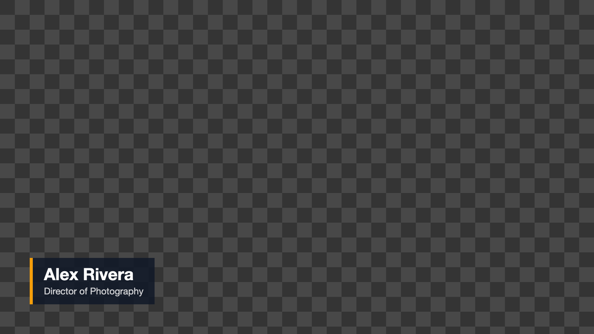
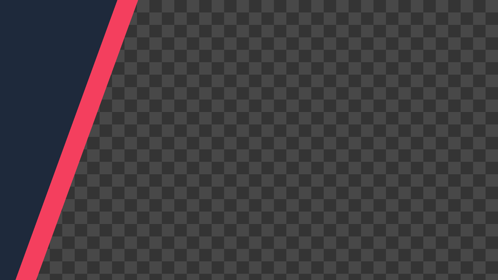
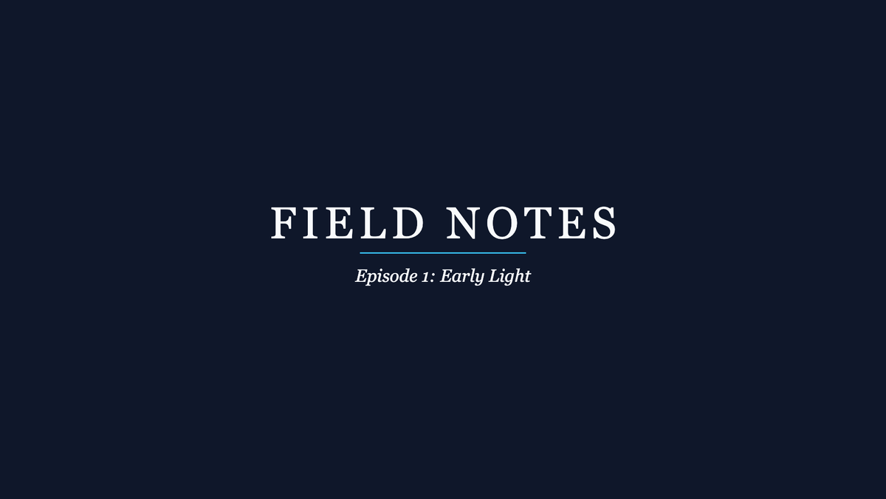
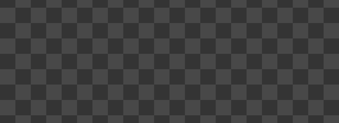

# Pulp

[](https://github.com/plutado/pulp/actions/workflows/ci.yml)
[](LICENSE)
[](https://www.electronjs.org/)
[](https://www.typescriptlang.org/)

Pulp is a desktop app for video editors who use motion-graphics templates: lower thirds, titles, transitions and overlays. You browse a library of templates, preview them, change their text, colors and fonts, and render them to files your editing software can use, including formats that keep the alpha channel so the graphic sits on top of your footage.

Templates use an open, documented format: a folder with a `template.json` manifest and an HTML/Canvas animation. Anyone can write one with a text editor, and there is no lock-in to a store or a subscription. Pulp also indexes your own media folders so templates and footage can be searched together.

"Pulp" is a working name and may change.

**Status: early development.** The renderer, the template format, search, categorization, template packs, drag-out to editing apps, the window shell, the card grid, the player, collections, image slots and layers are in place; social-ready export, 1.0 hardening and installers are still to come. Expect breaking changes to the format and the app until 1.0. See [ROADMAP.md](ROADMAP.md).


*The browse tree (Quick access, Types, Themes, Styles, Packs, Folders, with counts) on the left; the search bar with filter chips, sorting and the grid/list toggle over the stage — a live preview with play and scrub — and the results as cards with badges in the center; the inspector with its Parameters, Output and Info tabs on the right; the render tray and a status bar along the bottom. Panes resize and collapse, and the layout is remembered. All content shown is from the bundled sample templates.*

### Sample output

Frames rendered with the headless render mode (PNG sequence with alpha) and composited over a checkerboard so the transparent areas are visible.

| Lower Third Bar | Diagonal Wipe | Title Card |
|---|---|---|
|  |  |  |
| Transparent except for the name strap | Transparent outside the bands | Opaque by design (solid background) |

The lower third animating in, holding and animating out (15 fps preview of the 30 fps render):



## Who it is for

- Solo editors and YouTubers who need clean, consistent graphics without opening a motion-design app for every name strap.
- Small studios that want a shared, versionable library of house-style templates.
- Anyone who writes HTML/Canvas and wants to make templates for editors.

## What works today

- Library scan of the bundled samples and any folders you add: templates are validated; media files (video, image, audio) are indexed with tags from folder names and metadata from ffprobe, with cached thumbnails and preview in the app (video, image and audio play in the stage).
- Search with free text plus filters: `tag:`, `type:` (video, image, audio, or a taxonomy type or group such as `type:whoosh`, `type:transitions`), `theme:`, `style:`, `category:`, and from metadata `duration:>5`, `width:>=1920`, `height:`, `fps:`, `res:1080p` (also `4k`, `hd`), `codec:prores`, `alpha:yes`, `orientation:portrait`, `favorite:yes`, `recent:10`. Scope the search to Favorites, Recently used or one folder from the browse panel; narrow with filter chips (templates, video, images, audio, vertical, alpha, favorites); sort by relevance, name, recently used or duration. The last eight searches are remembered. Your tags and favorites are kept in the library database and survive folders going offline.
- Live preview with play, scrub, frame step and a loop toggle (templates open on their mid-progress frame, so transitions don't show a blank first frame), Set in / Set out marks that are the render's trim, volume and mute, a background of your choosing behind transparency (checkerboard, black, white or any colour) and a title-safe and action-safe overlay; hover a card to scrub through eight frames of it without opening it. Audio files show a waveform in the stage and in every list row, and audition mode walks a folder of sounds with the arrow keys, playing each as it comes up. A parameter form generated from the manifest: color pickers with alpha and recent colors, sliders, character counters, per-template undo/redo, saved parameter presets, and batch rendering from CSV.
- Rendering through ffmpeg to ProRes 4444 (alpha), ProRes 422 HQ, PNG sequence (alpha), QuickTime Animation (alpha), WebM VP9 (alpha), H.264 MP4 and, on macOS, HEVC with alpha — with frame-rate override, background flattening and in/out trim. Alpha import verified in Premiere Pro and DaVinci Resolve on macOS ([docs/nle-verification.md](docs/nle-verification.md)).
- Drag a finished render from the queue into your editor's bin or timeline, or "Prepare for drag" to render into a managed cache first; verified in Premiere Pro and Resolve on macOS.
- Template packs: import a `.zip` or folder with a license-and-collision preview, export the listed templates as a pack.
- A resizable window shell whose panes collapse and are remembered, a render queue in a bottom tray, and a status bar with ffmpeg, library counts, cache size and activity.
- Results as a grid of cards — thumbnail, name and badges for alpha, loop, duration, resolution and pack — or as a list with name, duration, type, themes and file columns, with the grid/list toggle and the thumbnail size in the search bar. Only what is in view is built, so a library of thousands scrolls smoothly.
- Collections: gather items while browsing (Add to collection, or drag a card into the tray), give each its own output settings, reorder them, apply one item's settings to all, save and reopen the collection as a file, and render the lot into one folder. A saved collection also records what a project used: items it can no longer find are flagged, not dropped.
- Vertical and square formats: a template is a shape, not a pixel size. It declares the aspects it draws for (16:9, 9:16, 1:1, 4:5), the Output tab picks the aspect and the resolution (standard sizes or a custom one) and the preview turns to match; `orientation:portrait` and a Vertical chip find tall items, cards take an item's own shape, and the safe-area overlay adds the zones a vertical video keeps clear. Every bundled set's lower third and title re-lay out for a tall frame.
- Sample media on demand: a "Sample media" folder of original CC0 sounds, music, stills and clips, made with ffmpeg and the renderer when you ask for it, so the browse tree has something under every media type.
- Image slots: a template says where a logo belongs and the picture is drawn inside the graphic's own layers, so it follows every move, fade and wipe without being keyframed. Choose one in the Parameters tab or drop a file on the well — it is copied into a managed Imported folder — with treatments (tinted, white, black, shadow, glow), an eye toggle to leave the spot deliberately empty, and a fallback to the template's own words when nothing is chosen. A template page is handed only the images picked for it, by id, never a path into your library.
- Layers: add your own lines of text and logos to a template, and they ride its animation by their position in the stack — a line added in the middle moves as the middle line of the design does. Each layer has its own typography (family, size as a share of the frame, weight, case, tracking, line height, colour, alignment, overflow) in one of ten bundled open-licence fonts or a font you import with a licence note of your own; behind Advanced, a layer can take a motion of its own — fade, slide, scale or none, after a delay — which still arrives and clears with the graphic. The Parameters tab is organised by part of the graphic rather than by kind of setting, and layers travel with saved presets, collections, the render cache, CSV batches and the command line.
- Find a category as you type: a field at the top of the browse panel lists matching nodes across every taxonomy — types, themes, styles, packs, folders — each named with the section it lives in, and choosing one scopes the results exactly as the tree does. The tree keeps one section open at a time so it stays short, and every type, theme and style in it is at least six samples deep, with no upper limit.
- A headless command-line render mode (below).

Not yet: moving and resizing layers on the stage with the mouse, social-ready export, 1.0 hardening and docs, installers and signed builds, verification on Windows. These are on the [roadmap](ROADMAP.md).

## What's next

The [roadmap](ROADMAP.md) breaks the path to 1.0 into milestones with task-level estimates. Estimates are working hours for one developer, including tests and docs.

Milestones 1-6, 10-13, 18, 19, 21-24 (renderer, alpha export, parameter editor, library, drag-out, template packs, the window shell, visual polish, categorization, browsing and preview, collections, vertical and square formats, the sample library, image slots, layers, and the browse panel's find field, accordion and six-deep coverage) are done, apart from verification items that need a Windows machine and the media slots held back until after 1.0. In planned order, what remains to 1.0:

| Milestone | What it delivers | Estimate |
|---|---|---|
| 25. Move and resize layers on the stage | Click a line or a logo in the preview to select it, drag it anywhere, scale it by its corner handles, nudge it with the arrows — snapping to the frame's centre lines, the safe areas and its block — with the position stored as fractions per aspect, carried by undo, presets, collections and CSV, and the template's motion still playing from wherever the layer was put | 16-22 h |
| 20. Social-ready export | Platform presets (aspect, resolution, frame rate, H.264/AAC, bitrate) with warnings when a render runs past a platform's length or file-size limit, a cover image, and handing the file to the system share sheet or the platform's upload page — no accounts, no posting through APIs | 8-13 h |
| 8. 1.0 hardening and docs | A JSON Schema for the template and pack formats with a stated compatibility rule (no version freeze), an authoring guide, an accessibility pass, local crash reporting, more sample templates, a user guide | 9-16 h |
| 17. Unsigned builds and releases | electron-builder, an app icon of Pulp's own and the names and shortcuts each system shows, unsigned macOS/Windows builds and a Linux AppImage, a draft-release workflow, the ffmpeg distribution decision | 8-14 h |
| 7. Signing and auto-update | macOS notarization, Windows code signing, electron-updater (blocked on account decisions) | 4-7 h |

The milestones through 1.0 total **278-448 hours**, of which **49-76 hours** are still open (the rest is done). Packaging and signing come last, after hardening: what is packaged should be the finished thing. Post-1.0 milestones (defaults per type and a guided setup, converting library media, audio with stems and paired effects, image parameters, a CLI, optional on-device semantic search) add 32-58 hours. The window layout these milestones build toward is described in [docs/ui-layout.md](docs/ui-layout.md).

## Template format

The format is specified in [docs/template-format.md](docs/template-format.md). Twenty-three original sample templates live in [`templates/`](templates/) and are released under CC0 1.0: three standalone samples and four matched sets, each a pack with a lower third, title, transition, overlay and background sharing one look — **Boardroom** (corporate: ink blue and paper white, hairline rules, measured motion), **Newsdesk** (broadcast: signal red on navy, bold capitals, a diagonal slash motif), **Matchday** (sports: volt yellow on black, chevrons, a score bug, snappy moves) and **Festival** (celebration, any season: warm gold on deep plum, bokeh and confetti, gentle bouncy motion).

## Built with

- Electron and TypeScript, built with electron-vite (Vite)
- A pure TypeScript core in `src/core` (manifest validation, parameter resolution, library indexer, search, render planning, shared UI state), tested with Vitest without Electron
- Preact with signals for the UI regions (pinned to Preact 10; decision record 0009)
- ffmpeg for encoding (installed separately)

Template packs (a `.zip` or folder with `pack.json` and one folder per template) can be imported with a preview of licenses, authors and id collisions, and exported from the listed templates; the format is in the template specification. Design notes: [docs/system-design.md](docs/system-design.md). Decisions: [docs/decisions/](docs/decisions/). Platform findings (Electron capture, ffmpeg versions, Windows and macOS): [docs/platform-notes.md](docs/platform-notes.md).

## Running it

Requirements: Node.js 22 or newer, npm 10 or newer, and ffmpeg on your PATH for rendering (macOS: `brew install ffmpeg`; Windows: `winget install Gyan.FFmpeg`; Linux: your package manager). The app runs without ffmpeg, but the Render button stays disabled and explains why.

```sh
npm install
npm run dev        # start the app with hot reload
npm test           # unit tests (no Electron or ffmpeg needed)
npm run lint       # eslint + TypeScript type checks
npm run build      # production build into out/
```

The first `npm run dev` downloads the Electron binary.

If ffmpeg is installed somewhere unusual, set `PULP_FFMPEG_PATH` to the full path of the executable.

### Headless rendering

After `npm run build`, templates can be rendered without the UI:

```sh
npx electron . --render pulp.samples.lower-third-bar --preset prores-4444 \
  --out renders/lower-third.mov --param "name=Sam Okafor" --param side=right
```

Preset ids: `prores-4444`, `prores-422hq`, `png-sequence`, `qt-animation`, `webm-vp9-alpha`, `h264-mp4`, and on macOS `hevc-alpha`.

`--fps <rate>` samples the template at another frame rate, one of the standard rates 23.976, 24, 25, 29.97, 30, 47.952, 48, 50, 59.94, 60, 100, 119.88 and 120 (a 30 fps template rendered at 60 fps gets twice the frames, same duration). `--background #RRGGBB` is the color alpha templates are flattened over in presets without alpha (default black). `--in-point` and `--out-point` are the first and last frame to render, inclusive, counted at the output rate: timecode such as `00:00:02:00` (semicolons for drop-frame at 29.97 and 59.94, three frame digits at 100 fps and above), a frame number such as `60`, or seconds such as `2.5s`. PNG sequences are numbered with the frame indices they hold, so a render from frame 60 starts at `_00060.png`. `--batch file.csv` renders one output per CSV row into the `--out` folder: headers match a parameter id or label (any case), a `name` column names the files, unknown columns are reported before rendering. `--library <folder>` adds a template folder for that run only (repeatable; not saved to settings). `--frame-timeout <seconds>` changes how long one frame may take before the template is treated as hung (default 10).

## Project layout

```
src/core/       pure TypeScript: format, params, library, search, render planning, ffmpeg detection
src/main/       Electron main process: window, IPC, template protocol, renderer
src/preload/    the window.pulp API exposed to the UI
src/renderer/   UI: one module per window region (Preact components and imperative hosts) over a shared state
src/shared/     types shared by preload and UI
templates/      bundled sample templates (CC0)
tests/          Vitest tests for src/core and the samples
docs/           specification, design, decisions
```

## Contributing

See [CONTRIBUTING.md](CONTRIBUTING.md).

## License

Code: MIT, see [LICENSE](LICENSE). Sample templates: CC0 1.0, see [templates/LICENSE-CC0.txt](templates/LICENSE-CC0.txt). Bundled fonts: SIL Open Font License 1.1, each with its own licence file in `fonts/`, credited in [docs/font-credits.md](docs/font-credits.md); they are not MIT. Pulp does not ship third-party media; templates and media you add stay under their own licenses.
