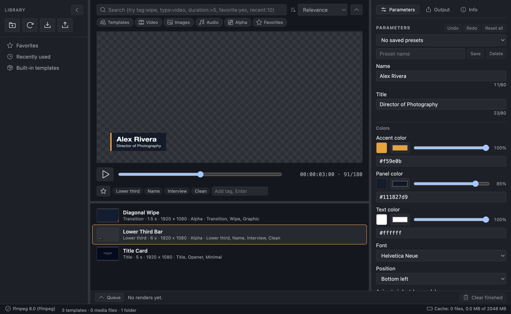

# Pulp

[](https://github.com/plutado/pulp/actions/workflows/ci.yml)
[](LICENSE)
[](https://www.electronjs.org/)
[](https://www.typescriptlang.org/)

Pulp is a desktop app for video editors who use motion-graphics templates: lower thirds, titles, transitions and overlays. You browse a library of templates, preview them, change their text, colors and fonts, and render them to files your editing software can use, including formats that keep the alpha channel so the graphic sits on top of your footage.

Templates use an open, documented format: a folder with a `template.json` manifest and an HTML/Canvas animation. Anyone can write one with a text editor, and there is no lock-in to a store or a subscription. Pulp also indexes your own media folders so templates and footage can be searched together.

"Pulp" is a working name and may change.

**Status: early development.** The core library, the template format, a basic UI and a first working renderer exist. Expect breaking changes to the format and the app until 1.0. See [ROADMAP.md](ROADMAP.md).



*The library on the left, the live preview with play and scrub in the middle, and the parameter form and render presets on the right. All content shown is from the bundled sample templates.*

### Sample output

Frames rendered with the headless render mode (PNG sequence with alpha) and composited over a checkerboard so the transparent areas are visible.

| Lower Third Bar | Diagonal Wipe | Title Card |
|---|---|---|
|  |  |  |
| Transparent except for the name strap | Transparent outside the bands | Opaque by design (solid background) |

The lower third animating in, holding and animating out (15 fps preview of the 30 fps render):


## Who it is for

- Solo editors and YouTubers who need clean, consistent graphics without opening a motion-design app for every name strap.
- Small studios that want a shared, versionable library of house-style templates.
- Anyone who writes HTML/Canvas and wants to make templates for editors.

## What works today

- Library scan of the bundled samples and any folders you add: templates are validated, media files (video, image, audio) are indexed with tags derived from folder names.
- Search with free text plus filters: `tag:`, `type:`, `category:`, and from metadata `duration:>5`, `width:>=1920`, `height:`, `fps:`, `res:1080p` (also `4k`, `hd`), `codec:prores`, `alpha:yes`, `favorite:yes`, `recent:10`. Add your own tags and favorites to any item; they are kept in the library database and survive folders going offline.
- Live preview with play and scrub, and a parameter form generated from the manifest.
- Rendering through ffmpeg to ProRes 4444 (alpha), ProRes 422 HQ, PNG sequence (alpha), WebM VP9 (alpha) and H.264 MP4. Verified on macOS with the bundled samples; see the roadmap for what is not yet verified.
- A headless command-line render mode (below).

Not yet: drag-out to editing apps, template pack import, media preview, user tags, installers. These are on the [roadmap](ROADMAP.md).

## What's next

The [roadmap](ROADMAP.md) breaks the path to 1.0 into milestones with task-level estimates. Estimates are working hours for one developer, including tests and docs.

| Milestone | What it delivers | Estimate |
|---|---|---|
| Production-quality renderer | End-to-end render tests checked with ffprobe, explicit HiDPI handling, 4K/8K and portrait sizes, raw RGBA piping instead of PNG, documented color handling, a render queue | 12-20 h |
| Alpha export and NLE verification | Each alpha preset verified in Premiere Pro, DaVinci Resolve and Final Cut Pro, straight vs. premultiplied alpha settled, QuickTime Animation and HEVC-with-alpha presets | 8-14 h |
| Parameter editor | Color picker with alpha, sliders, saved parameter presets per template, batch renders from CSV, undo/redo | 10-16 h |
| Library | User tags, a persistent index with file watching, ffprobe metadata filters, cached thumbnails, media preview | 12-20 h |
| Drag-out to editing apps | Drag a rendered file, or render on drag, straight into an NLE bin or timeline, verified on macOS and Windows | 8-16 h |
| Template packs | A documented pack format, zip import with validation and license display, pack export | 6-10 h |
| Packaging and 1.0 | Signed installers for macOS, Windows and Linux with auto-update; frozen format v1 with a JSON Schema, an authoring guide, an accessibility pass, more sample templates | 18-32 h |

Total through 1.0: **74-128 hours**. Post-1.0 items (image and media parameters, audio in templates, a separate CLI, optional on-device semantic search) add 12-26 hours.

## Template format

The format is specified in [docs/template-format.md](docs/template-format.md). Three original sample templates live in [`templates/`](templates/) and are released under CC0 1.0.

## Built with

- Electron and TypeScript, built with electron-vite (Vite)
- A pure TypeScript core in `src/core` (manifest validation, parameter resolution, library indexer, search, render planning), tested with Vitest without Electron
- ffmpeg for encoding (installed separately)

Design notes: [docs/system-design.md](docs/system-design.md). Decisions: [docs/decisions/](docs/decisions/). Platform findings (Electron capture, ffmpeg versions, Windows and macOS): [docs/platform-notes.md](docs/platform-notes.md).

## Running it

Requirements: Node.js 22 or newer, npm 10 or newer, and ffmpeg on your PATH for rendering (macOS: `brew install ffmpeg`; Windows: `winget install Gyan.FFmpeg`; Linux: your package manager). The app runs without ffmpeg, but the Render button stays disabled and explains why.

```sh
npm install
npm run dev        # start the app with hot reload
npm test           # unit tests (no Electron or ffmpeg needed)
npm run lint       # eslint + TypeScript type checks
npm run build      # production build into out/
```

The first `npm run dev` downloads the Electron binary.

If ffmpeg is installed somewhere unusual, set `PULP_FFMPEG_PATH` to the full path of the executable.

### Headless rendering

After `npm run build`, templates can be rendered without the UI:

```sh
npx electron . --render pulp.samples.lower-third-bar --preset prores-4444 \
  --out renders/lower-third.mov --param "name=Sam Okafor" --param side=right
```

Preset ids: `prores-4444`, `prores-422hq`, `png-sequence`, `webm-vp9-alpha`, `h264-mp4`.

`--fps <rate>` samples the template at another frame rate, one of the standard rates 23.976, 24, 25, 29.97, 30, 47.952, 48, 50, 59.94, 60, 100, 119.88 and 120 (a 30 fps template rendered at 60 fps gets twice the frames, same duration). `--background #RRGGBB` is the color alpha templates are flattened over in presets without alpha (default black). `--in-point` and `--out-point` are the first and last frame to render, inclusive, counted at the output rate: timecode such as `00:00:02:00` (semicolons for drop-frame at 29.97 and 59.94, three frame digits at 100 fps and above), a frame number such as `60`, or seconds such as `2.5s`. PNG sequences are numbered with the frame indices they hold, so a render from frame 60 starts at `_00060.png`. `--batch file.csv` renders one output per CSV row into the `--out` folder: headers match a parameter id or label (any case), a `name` column names the files, unknown columns are reported before rendering. `--library <folder>` adds a template folder for that run only (repeatable; not saved to settings). `--frame-timeout <seconds>` changes how long one frame may take before the template is treated as hung (default 10).

## Project layout

```
src/core/       pure TypeScript: format, params, library, search, render planning, ffmpeg detection
src/main/       Electron main process: window, IPC, template protocol, renderer
src/preload/    the window.pulp API exposed to the UI
src/renderer/   UI (plain TypeScript and DOM)
src/shared/     types shared by preload and UI
templates/      bundled sample templates (CC0)
tests/          Vitest tests for src/core and the samples
docs/           specification, design, decisions
```

## Contributing

See [CONTRIBUTING.md](CONTRIBUTING.md).

## License

Code: MIT, see [LICENSE](LICENSE). Sample templates: CC0 1.0, see [templates/LICENSE-CC0.txt](templates/LICENSE-CC0.txt). Pulp does not ship third-party media; templates and media you add stay under their own licenses.
